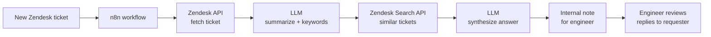

# AI-Powered IT Support Assistant

**Turning tribal knowledge into instant answers for a global IT team.**

As IT Technical Lead supporting 450+ employees across North America, EMEA, and APAC with a three-engineer team, I built an AI assistant that reads every new Zendesk ticket, finds similar past resolutions, and drafts a recommended action plan as an internal note — within minutes of ticket creation. Monthly operating cost: a few dollars.

## The problem

Most tickets were repeats or variations of solved issues — yet each one still cost an engineer 30 minutes to hours of manually digging through ticket history. Worse, IT doesn't own every system in the company, so engineers also burned time tracking down who owned what before they could even start troubleshooting. Knowledge lived in closed tickets and in people's heads.

## How it works

An n8n workflow processes each new ticket:

1. **Fetch** — pull the ticket via the Zendesk API.
2. **Understand** — a language model summarizes it and extracts keywords.
3. **Retrieve** — keywords go into the Zendesk Search API to find similar historical tickets from a corpus of ~18,000.
4. **Synthesize** — the model drafts troubleshooting steps grounded in those past resolutions.
5. **Deliver** — the draft lands as an **internal note** with an action plan for the engineer, including system-ownership context, so nobody has to hunt down who owns what.

## Key design decisions

- **Human-in-the-loop by architecture.** AI output only ever appears in internal notes — never customer-facing. Engineers review and send the final reply. Quality control is structural, which made adoption safe from day one.
- **Grounded in real resolutions.** Every suggestion is synthesized from the team's own ticket history, not generated open-ended — sharply reducing hallucination on environment-specific issues.
- **Keyword extraction before retrieval.** A dedicated extraction step beats feeding raw ticket text into search.
- **Radically cost-efficient.** Small, inexpensive models plus n8n orchestration: a few dollars a month, no new SaaS spend, no per-seat AI add-on.

## Results

- First response on suitable tickets went from **~30 minutes–hours to as fast as 10 minutes** — the manual history-search step is gone.
- Engineers start from a relevant past resolution instead of a blank page.
- The system-ownership lookup disappeared: the internal note arrives with the context needed to act.

## Example *(illustrative — synthetic, not a real ticket)*

> **Based on similar tickets** (keywords: VPN, macOS), here's a recommended internal response:
>
> **Observed patterns** — VPN failures after macOS updates are usually profile- or keychain-related; most resolve by re-importing the configuration profile.
>
> **Action plan** — 1) Confirm macOS and VPN client versions. 2) Check whether the keychain entry survived the update. 3) Re-import the profile from the self-service portal; escalate to the network team if authentication still fails.
>
> **Reply template** — a 4–6 sentence customer-facing draft the engineer can adapt before sending.

## Security & what's next

Built for internal use within a small IT team with full ticket access. Next hardening steps: PII redaction before content leaves for the model API, retention review, and audit logging. On the roadmap: confidence scoring on drafts and extending retrieval to the internal knowledge base.

**Stack:** n8n · Zendesk API · OpenAI API

---

More about me: [yijunliu.sperobill.com](https://yijunliu.sperobill.com)
